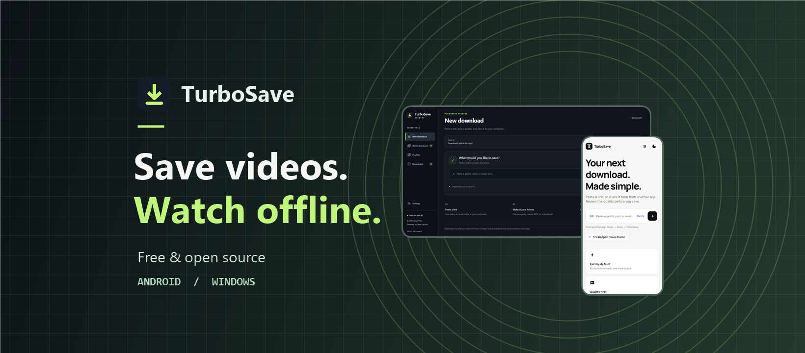

<p align="center"></p>

<h1 align="center">TurboSave</h1>

<p align="center">Paste a link, choose a quality, and save videos for offline playback. TurboSave runs on Android and Windows without a TurboSave account.</p>

<p align="center">
  <a href="https://github.com/chanthupaa/TurboSave/releases">Releases</a> ·
  <a href="android/">Android source</a> ·
  <a href="desktop/">Windows source</a> ·
  <a href="https://github.com/chanthupaa/TurboSave/issues">Report an issue</a>
</p>

> **Installation status:** GitHub currently offers source downloads for Android and Windows. The latest source is on `main`. The tagged prereleases are earlier snapshots and have no APK or Windows executable attached. See the [Android release checklist](android/RELEASE_READINESS.md) and [Windows dependency-source review](desktop/DEPENDENCY_SOURCES.md) for the remaining work.

## What you can do

- **Android:** Share or paste a video link, review available formats, and open saved media from your local library.
- **Windows:** Pick a folder, queue a batch, or select videos from a public YouTube playlist. The latest beta source adds a filename warning and an optional visual duplicate check that samples short sections before you start the full download.

## See the apps

| Windows desktop | Android phone |
| --- | --- |
|  |  |

These are **UI previews rendered from the checked-in source** with empty or example data. They do not claim a successful download or a packaged-app test.

## Pick your platform

| | Android | Windows |
| --- | --- | --- |
| Current source | [1.5.3+13](android/) | [0.8.0-beta.5](desktop/) |
| Main flow | Share or paste a link, review quality, save to the phone | Paste a link, choose media and destination, follow progress |
| More tools | Activity and local media library | Batch downloads, YouTube playlist selection, history, pause and resume |
| Tagged source snapshot | [Android 1.5.3 prerelease](https://github.com/chanthupaa/TurboSave/releases/tag/android-v1.5.3-source) | [Windows beta.5 prerelease](https://github.com/chanthupaa/TurboSave/releases/tag/desktop-v0.8.0-beta.5-source) |
| Build guide | [Android README](android/README.md) | [Windows build guide](desktop/BUILD_GUIDE.md) |

Available qualities and sites depend on the source. DRM, sign-in requirements and source restrictions still apply. TurboSave does not bypass them. The separate [Web project](https://github.com/chanthupaa/turbosave-web) is maintained outside this repository.

## Build from source

Clone the repository, then use the instructions for your platform. Generated builds, recovery archives, local signing material and private user data are excluded from Git.

<details>
<summary><strong>Android</strong> · Flutter and Android SDK</summary>

From `android/`:

```powershell
flutter pub get
flutter analyze --no-pub lib test
flutter test --no-pub
```

The APK build needs local signing configuration. See the [Android README](android/README.md) and [release readiness](android/RELEASE_READINESS.md). Never commit a signing key.

</details>

<details>
<summary><strong>Windows</strong> · Node.js, Electron, yt-dlp and FFmpeg</summary>

From `desktop/`:

```powershell
npm ci
npm run tools:prepare
npm test
npm run build
```

See the [build guide](desktop/BUILD_GUIDE.md) and [dependency-source review](desktop/DEPENDENCY_SOURCES.md) before distributing the bundled installer.

</details>

## Help improve TurboSave

For a bug, [open an issue](https://github.com/chanthupaa/TurboSave/issues) with the app, version, OS and reproduction steps. Remove private URLs, usernames, paths, cookies and credentials. Security reports belong in a private channel; see [SECURITY.md](SECURITY.md). Contributions are welcome through the [Android](android/CONTRIBUTING.md) and [Windows](desktop/CONTRIBUTING.md) guides.

TurboSave's original application code is [GPL-3.0-only](LICENSE). Third-party components keep their own licenses and notices in each platform folder. Use TurboSave only for media you have permission to save.
